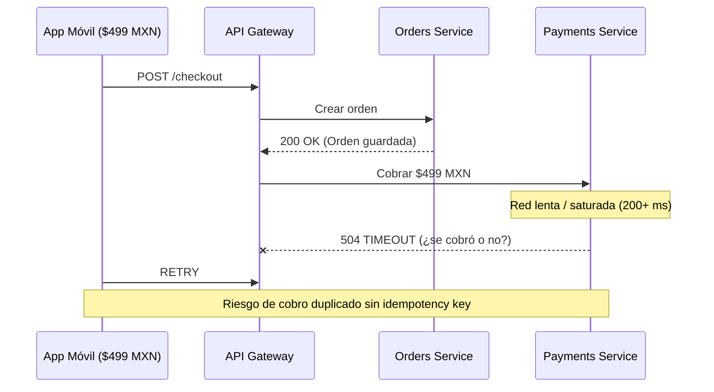

# Día 1/13: Monolito vs Microservicios (Trade-offs de arquitectura)

> Referencia de estudio: **Cap. 1** de *Designing Data-Intensive Applications* (Martin Kleppmann y Chris Riccomini).
> Versión interactiva: [cap01-monolito-vs-microservicios.html](./cap01-monolito-vs-microservicios.html) · Versión PDF (2 págs.): [cap01-monolito-vs-microservicios.pdf](./cap01-monolito-vs-microservicios.pdf)

---

## La idea central en 10 segundos

Partir una app de 500 usuarios en 20 microservicios no te convierte en Netflix: solo cambia llamadas en memoria de **~100 nanosegundos** por llamadas de red de **cientos de milisegundos** y te regala **fallos parciales** que en un monolito ni existen.

**Regla del Cap. 1:** escala verticalmente primero (mejor máquina, mejor índice, mejor caché). Distribuye solo cuando un nodo ya no aguanta el tráfico o cuando el tamaño del equipo provoca choques constantes al desplegar.

---

## Glosario rápido (términos que sí o sí debes conocer antes de empezar)

| Término | Explicación en 1 línea |
| :--- | :--- |
| **Monolito** | Toda tu app (auth, órdenes, pagos) vive y se despliega en un solo proceso/servidor. |
| **Microservicios** | Tu app partida en servicios independientes que se comunican por red (HTTP/gRPC). |
| **Latencia (`ns` vs `ms`)** | Tiempo de respuesta; `1 ms` equivale a `1,000,000 ns` (la red es órdenes de magnitud más lenta que la RAM). |
| **Transacción ACID / Rollback** | Operación todo-o-nada en una DB; si falla un paso, revierte todo sin dejar datos a medias. |
| **Fail-stop (fallo atómico)** | El nodo completo se detiene al fallar; es obvio de detectar y limpio de reiniciar. |
| **Fallo parcial** | En red distribuida, unos servicios siguen vivos (`200 OK`) mientras otro muere (`504`), dejando estado ambiguo. |
| **Idempotency-Key** | Identificador único por operación (UUID) que evita cobrar dos veces si el cliente reintenta un pago. |
| **Escalado vertical vs horizontal** | Vertical = máquina más potente (`+CPU/+RAM`); horizontal = repartir carga en varios servidores. |

---

## 1. Tabla comparativa: Monolito vs Microservicios

| Dimensión | Monolito (1 nodo en RAM) | Microservicios (red distribuida) |
| :--- | :--- | :--- |
| **Comunicación interna** | Llamada a función en memoria (`~100 ns`) | Llamada por red HTTP/gRPC (`10 ms` a `200+ ms`) |
| **Tipo de fallo** | **Fail-stop atómico:** cae toda la app parejo, reinicias y vuelve limpia | **Fallo parcial:** una parte responde `200 OK` y otra muere con `504 TIMEOUT` |
| **Consistencia de datos** | Transacciones ACID locales en 1 base de datos | Transacciones distribuidas, sagas, retries e idempotencia obligatoria |
| **Complejidad operativa** | 1 deploy, 1 log, debugging directo | Orquestación (K8s), trazas distribuidas, service discovery, versiones cruzadas |
| **Cuándo conviene** | 9 de cada 10 productos al inicio, equipos pequeños/medianos, tráfico que cabe en 1 servidor moderno | Tráfico que rebasa el límite físico de 1 nodo o **20+ programadores** pisándose en cada deploy |

---

## 2. El caso real de producción: fallo parcial en Checkout

Cuando separas `Orders` y `Payments` en servicios distintos conectados por red, una compra simple puede quedar a medias:



**Versión texto rápido (sin Mermaid):**

```text
[App: PAGAR $499] -> [API 200 OK] -> [Orders: GUARDADA]
                                            |
                                    (red lenta: 200 ms)
                                            v
                                [Payments: 504 TIMEOUT]
                                            |
                          [Retry #1, #2, #3 -> ¿Cobro doble?]
```

- **En un monolito:** la orden y el registro de pago corren en el mismo proceso y la misma base; si algo truena, la transacción hace `ROLLBACK` completo.
- **En microservicios:** `Orders` ya dijo que sí, `Payments` no contestó a tiempo, y tu app no sabe si el cargo pasó o se perdió en el camino.

---

## 3. Los 2 criterios de Kleppmann para distribuir

```js
if (traffic > 1_node || devs >= 20) {
  distribute(); // Justificado: escala técnica u organizacional
} else {
  scaleVerticalFirst(); // 1 servidor moderno (64 vCPU, 256 GB RAM) aguanta 10k+ req/s
}
```

1. **Criterio técnico (tráfico/datos):** ya optimizaste consultas, índices y hardware vertical, y tu carga real rebasa lo que una sola máquina puede manejar (o necesitas alta disponibilidad multirregión estricta).
2. **Criterio organizacional (equipo):** tienes suficientes programadores (referencia práctica: ~20+ devs) trabajando en el mismo repositorio y pisándose cada vez que despliegan a producción.

---

## 4. Tres preguntas reales de entrevista (System Design)

### 1) ¿Por qué los reintentos causan cobros duplicados y cómo se evita?
Cuando un cliente recibe `504 TIMEOUT`, no sabe si el servidor de pagos nunca recibió la petición o si sí la procesó y se perdió la respuesta. Si reintenta sin control, el cargo puede aplicarse dos veces.
- **Respuesta clave:** usar **`idempotency keys`** (un UUID generado por el cliente antes del primer intento). El servidor guarda la llave junto al resultado del pago; si llega un retry con la misma llave, devuelve el resultado original sin volver a cobrar.

### 2) ¿Cuándo conviene escalar verticalmente vs horizontalmente?
- **Escala vertical (máquina más grande):** más barata en horas de ingeniería, mantiene transacciones ACID simples y evita latencia de red. Un servidor moderno con NVMe, 64 vCPU y 256 GB de RAM aguanta miles de peticiones por segundo.
- **Escala horizontal (más nodos):** obligatoria cuando alcanzas el techo físico de hardware, necesitas tolerancia a caída total de un datacenter o requieres aislar despliegues entre múltiples equipos independientes.

### 3) ¿Qué es un "monolito distribuido" y por qué es el peor escenario?
Ocurre cuando separas el código en varios microservicios, pero todos siguen leyendo y escribiendo sobre la **misma base de datos** o requieren desplegarse sincronizados para no romperse.
- **Por qué duele:** te quedas con toda la latencia, timeouts y fallos parciales de un sistema distribuido, pero sin independencia real de despliegue ni aislamiento de fallas.

---

## Siguiente episodio (Día 2/13)

**Cap. 2: Promedio vs p99 (Tail Latency).** Por qué presumir que tu API responde en 20 ms promedio oculta que tu 1% de usuarios más activos espera 4 segundos.

Síguenos en [@tlacuachedev](https://instagram.com/tlacuachedev) para no perderte el Día 2.
